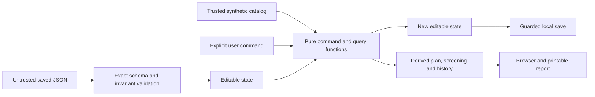

# Current demo architecture

Technical authority as of October 18, 2026 (integrated roles, phone UI and room capture prototype; see the [overnight acceptance record](overnight-acceptance-2026-10-18.md)). This supersedes the production infrastructure and optional 3D roadmap in the preserved `fixlist-plan.md`. Andrew authorized advancing the scaffold into a working local journey, emphasizing business logic and tests over visual design. See the [implementation plan](superpowers/plans/2026-10-17-core-workflow.md), [product hypothesis](product-validation.md), and [current execution evidence](validation-facts-catalog-2026-10-17.md).

## Objective and implementation boundary

Demonstrate a repeatable chain: fictional room observation → checklist answer → separate human confirmation → computed action plan → fact-based fictional screening → local family request history → printable report. The demonstration must work without implying real assessment, approval, outreach, identity verification, or repair verification.

The previous core domain, storage, browser and print journey has recorded acceptance evidence; the roles domain/storage increment is implemented and awaits parent review. Phone-first resident/helper/volunteer screens are implemented; see `roles-ui-implementation-report.md` for execution evidence and remaining native-print limits. The validation report separates deterministic coverage, actual desktop/native print inspection, the bounded iOS Safari check and remaining product questions. Eight concerns across five text-only fictional rooms exercise the architecture. Seven fixed fictional profiles and two invented programs demonstrate matching, failure and missing facts. This describes the earlier core increment. Native capture and its guided photo fallback are now in the authorized rough prototype; no backend or real accounts are included.

Update 2026-10-18: The current local demo also includes on-device photos and an optional Gaussian-splat room scan/viewer with v2 AI areas-to-review suggestions. These remain user-controlled references; they do not detect hazards, confirm concerns, or assess safety. See the [roles journey spec](roles-journey-spec.md), [scan viewer report](scan-viewer-2026-10-17.md), [suggestion UI report](scan-suggestions-ui-2026-10-17.md), [v2 suggestions contract](suggestions-v2-contract.md), and [AI disclosures](ai-disclosures.md).

Following Andrew's request to retain useful parts of the larger proposal, this local-demo scope remains in place. The [plan integration review](plan-integration-review.md) selects its useful additions: fact-based screening over fictional profiles, a small structured concern/action catalog, funding-work relevance distinct from applicant criteria, and later one-county resource verification. The first two increments are now implemented: fact screening and the expanded catalog, including work relevance. The one-county resource pilot remains gated. See [current acceptance evidence](validation-facts-catalog-2026-10-17.md). Keep all rules in the existing TypeScript domain and data layers.

Update 2026-10-18: The real ACL Eldercare Locator is now included alongside the two fictional programs; the broader county-specific directory pilot remains gated. See the [roles journey spec](roles-journey-spec.md) for the current demo resource scope.

## Structure and dependencies

| Location | Responsibility |
| --- | --- |
| `src/data/demo-scenario.ts` | Trusted authored synthetic catalog: rooms, observations, checklist/action links, eight concerns/actions and two fictional program rule trees. |
| `src/data/fictional-profiles.ts` | Five typed fact definitions and seven fixed fictional profiles. |
| `src/domain/types.ts`, `roles.ts` | Catalog, actor, grant, photo, sharing and revisioned help-request contracts; frozen old family types are for migration only. |
| `src/data/demo-people.ts`, `local-help-resources.ts` | Fixed fictional demo identities and separately sourced ACL resource. |
| `src/domain/role-views.ts` | Granted household views, field-limited volunteer projections and next-step selectors. |
| `src/domain/workflow.ts` | Editable state, typed commands, immutable transitions, initial state, request activity views; shared public import surface. |
| `src/domain/rules.ts` | Confirmation prerequisites, canonical timestamp checks, fixed fictional identities and history notices. |
| `src/domain/plan.ts` | Derived grouped actions, evidence and selection/order explanations. |
| `src/domain/fact-screening.ts` | Typed rule validation and full three-valued explanation trees. |
| `src/domain/screening.ts` | Program status and independent work-category relevance. |
| `src/domain/catalog.ts`, `coverage.ts` | Authored catalog integrity and per-room sample answer coverage. |
| `src/lib/demo-storage.ts`, `state-validation.ts`, `legacy-demo-state.ts` | Exact reconstruction, frozen legacy migration, origin-local persistence and owned-store reset. |
| `src/lib/photo-storage.ts` | JPEG re-encoding/downsize and serialized IndexedDB photo storage. |
| `src/app/` | Typed hash routes, phone shell, people/guides, capability-gated resident/helper screens, projection-only volunteer screens, compensated photo handlers and print view. Business rules remain in the domain. |
| `src/i18n/` | English source dictionary, Spanish key parity and unreviewed marker, interpolation/context hook, ID-based catalog translations and bounded authored-domain explanation translation. User writing is never translated. |
| `src/styles/` | Plain screen/print CSS tokens, native controls and visible focus. Design rules are in `frontend-design-2026-10-17.md`. |
| `docs/` | Decisions, source review, evidence, recording plan and factual assistance log. |
| `recordings/` | Ignored local screenshot/video/PDF evidence; only its README is tracked. |

Use the exact installed dependency versions in `package.json` and `package-lock.json`, Node **24.18.0** and npm **11**. This increment changes no dependencies. React/TypeScript/Vite, local fonts and the separately lazy-loaded three.js/Spark scan viewer remain the existing stack; Capacitor packaging is separate work. Persistence uses localStorage plus dedicated IndexedDB photo/scan/capture stores, with no backend, server database, analytics or remote API.

Update 2026-10-18: Capacitor 8.5.3 now packages the Vite app as an iOS demo; `npm run ios:demo` builds, syncs and bundles one private scan in the ignored iOS app assets. See [README run instructions](../README.md) and the [roles journey spec](roles-journey-spec.md).

The initial JavaScript budget remains **250 KiB gzip**. Report Vite's measured output separately from this budget; it does not establish latency. Add dependencies only for a demonstrated need.

Navigation comparison prototype (2026-10-18, parent acceptance pending): `src/app/navigation-layouts.ts` defines the default Home / Check / Plan / Help / More layout and two optional task layouts: Home / Rooms / Requests, and Home / Rooms / Fix list / Requests. The settings selector or a one-use `?nav=current|three|four` launch override chooses the layout; its validated `layout` field lives in the separate `fixlist:navigation:v1` record, with older records defaulting to current and reset removing the preference. Existing hash routes and household schema remain unchanged. In the task layouts, Rooms includes the permitted scan entry, Requests includes local-help resources, and one header account/settings entry opens the existing More screen with guide help/disclosure. Volunteer tabs and domain grants remain unchanged. See [implementation evidence and remaining runtime checks](navigation-layout-prototype-report-2026-10-18.md).

## State and computation

`DemoState` payload schema 5 stores one Maple House household owned by Margaret, fictional demo people (Margaret, Sam, Alex, Jordan and user-created profiles), explicit delegation scopes, per-person language/guide/checklist progress, answers and attribution, separate confirmations and last-change attribution, an allowlisted screening profile ID, request episodes and professional-referral records, a live photo metadata index with bounded deletion attribution, and the active person ID. There is exactly one resident; `create_person` cannot replace that resident. Roles of existing people cannot be edited. Plans and screening results remain derived from trusted catalog data.

Every `DemoCommand` requires `actorId` and a caller-supplied canonical ISO `at`. `applyCommand` enforces roles, grants, ownership, lifecycle and revisions without reading the clock, touching storage or sending messages. Attribution survives delegation revocation. Last-change attribution includes explicit unconfirmation and automatic confirmation removal after an answer changes. Fixture timestamps describe authored demo records; migrated records with unknown creation times retain null rather than inventing a time.



This is an internal typed interface, not an authenticated API accepting arbitrary network JSON. Its defensive guards do not establish a secure production API. A future server needs its own command parser, authorization, consent and ownership rules.

## Confirmation and computed plan

Checklist values are `unknown | yes | no`. Yes alone creates no plan item. A concern requires a nonempty valid evidence chain, known backing checklist/action IDs, matching action references, yes for every backing answer, and separate explicit family confirmation. Changing a backing answer away from yes clears dependent confirmations in that transition. Restoring yes still requires another confirmation.

`computePlan` selects confirmed concerns, groups them by reference action, deduplicates evidence, and orders actions by authored catalog position with stable concern/evidence IDs. The explanation names the source concerns and ordering rule. This is demonstration review order, not a validated priority/risk score. Action text remains synthetic example content, not professional guidance or a complete home assessment.

## Assistance screening

`evaluateFactRule` validates typed boolean, bounded numerical and enum definitions; the entire predicate tree; and all supplied facts before evaluating anything. Supported operations are equality, inclusive `gte`/`lte`, `all` and `any`. Missing/null facts remain unknown; false and zero remain known. Exact shapes, compatible types, unique IDs, maximum depth 8 and maximum 64 nodes reject malformed or hidden invalid branches. Ordinary getters/custom prototypes are rejected without execution; proxies are outside the JSON-data contract.

`all` uses failure, then unknown, then met; `any` uses met, then unknown, then failure. Every child explanation remains available. `screenProgram` derives `known_criterion_not_met`, `needs_information` or `criteria_matched` from that result. Invalid definitions/facts show screening unavailable. Seven fixed fictional profiles exercise two clearly invented programs; there are no editable criterion outcomes or private household inputs.

Work relevance independently compares the current confirmed actions' authored funding tags with a program's authored coverage tags. Its states are relevant, not relevant, and no confirmed work to compare. A relevant action does not make a failing or unknown applicant match, and matched applicant criteria do not imply relevant work. Unmodeled requirements remain visible. Both programs are synthetic, explicitly nonexistent, with no contact or verification date. No result establishes real eligibility, availability, funding or approval.

The catalog is validated before rendering. Actions carry unknown cost, an authored family/professional review route, funding tags, and a separate CDC checklist reference. Reference material does not verify the fictional observation, routing, cost or ranking. Professional-review requests record seeking suitable help; the fictional helper label does not establish qualifications. `computeCoverage` counts answered/unknown questions per room. Fully answering eight sample questions is not a complete assessment or a safety finding.

U09 presentation follow-up (2026-10-18, parent acceptance pending): `src/app/checklist-presentation.ts` distinguishes an unattributed `unknown` (**Not answered**) from an attributed `unknown` (**Not sure**) without changing saved values or domain rules. UI/print counts include explicit Not sure in answered, show its count separately, and show not-answered counts. Unknown room styling stays unresolved; confirmation still requires Yes and a separate command. Phone resume chooses the first unanswered question, skipping explicit Not sure; with no unanswered questions, existing uncertain next steps are labelled as review. Legacy known Yes/No values remain answers even without attribution. See [follow-up evidence and exact en/es copy](unanswered-display-icons-report-2026-10-18.md).

## Permissions and help-request history

The resident alone approves sharing, invites/cancels volunteers, cancels requests, grants/revokes delegation, changes the household screening profile, agrees visit proposals, and acknowledges/reopens completion reports. Sam and created family helpers require independent `checklist`, `confirm`, and `requests` grants to answer/add photos, confirm/unconfirm, or create drafts. Confirmation also requires checklist access to supporting evidence. The resident may remove any household photo; a contributor may remove their own photo even after delegation is revoked. Deletion retains bounded attribution. Any known demo person may create another demo profile, switch the active person, and change their own language/guide/resume preferences; these operations grant no household access. Volunteer skills/availability remain self-reported and unverified.

A request can be created only from the active confirmed plan, with `expectedRevision: 0`; it starts at revision 1. Action episodes distinguish recurring concerns from old work. Cancelling permits a new request with the next deterministic ordinal ID; reconfirming an action after it left the plan starts a new episode. Earlier requests remain history and cannot supply current completion. Every subsequent request mutation requires its current `expectedRevision`, increments it once, and appends an actor/time event. Lifecycle: draft → invited → accepted (or declined) → scheduled after a volunteer proposal and resident agreement → in_progress on the first update → volunteer_reported_done → resident_confirmed_done, or back to in_progress on “Not done yet”. Updates are 1–280 characters. The assigned volunteer alone accepts/declines, proposes, updates, reports done or withdraws. Duplicate acceptance and illegal/stale changes fail.

Withdrawal or resident `cancel_invitation` returns an open assignment to draft and clears assignment-specific details and sharing; decline retains `declined` with no assigned volunteer. The resident can prepare sharing and invite another volunteer from draft/declined. `cancel_request` is terminal and retained as history; confirmed completion is also terminal. Previous events remain. Professional actions have local referral records progressing through `recorded`, `contacted`, and `closed`; these record human-reported activity and never contact a professional. They cannot invite volunteers; both authored effort and routing are checked. No electrical, structural, plumbing or grab-bar work is assigned to a volunteer. Independent verification is explicitly “not available in this demo”.

Removing confirmation retains requests as inactive history and suspends volunteer visibility and ordinary mutations. Privacy reductions (revoke sharing, cancel invitation/request, withdraw) remain possible while inactive. Reconfirming an action that left the plan creates a new episode without verifying a repair or deleting history. No time-based invitation expiry is invented: the spec provides no expiry interval; cancelled, declined, withdrawn and inactive assignments fail closed.

Ordinary request edits stop at 120 history events. Eight additional entries reserve space for sharing-field revocations, assignment release, final request cancellation and completion review; both completion decisions can use the reserve. Storage accepts at most 128 events and requires enough free entries for every remaining revocation and exit. Events are preserved. Identical time proposals, sharing settings, field revocations and consecutive progress updates return unchanged state without consuming a revision or history entry.

`visibleRequestsFor(scenario, state, actorId)` constructs volunteer projections field-by-field. Only active invitations/assignments for that person appear. Title/nextStep and coordination records are always included; roomName, resident-owned photos for the action, an opaque scan-location ID, visitTimes and areaLabel have no object key unless shared during a live assignment. Completed assignments retain coordination history but receive no shared fields or future photos. Whole requests, history, household answers and whole scans never enter this projection. Revocation removes a key immediately; the UI must say “They may already have seen this. Revoking stops future access on this device.” `visibleHouseholdFor` gives checklist/photos/scan capability for `checklist`, confirmation records for `confirm`, plan for `confirm` or `requests`, and request details for `requests`; volunteers receive null. These are local demo boundaries, not authenticated security against access to the device itself.

`elderNextStep` prioritizes completion review and visit agreement, then unanswered checklist (resuming the saved position), confirmable yes concern, create/invite or find professional, referral tracking, wait, then done. Helpers have a capability-aware next-step selector. The explicit wait result avoids calling pending volunteer work done. `volunteerNextStep` uses only visible assignments. Neither selector marks concerns safe or repairs verified.

## Catalog and photos

Each action has an authored `nextStep`, `effort` (`quick_fix`, `helper_task`, `professional`), and “Based on CDC 2017 Check for Safety” label alongside its existing guidance reference. `groupPlanByEffort` preserves catalog order within each group and explains: “Grouped by who can usually do it — a reading aid, not a risk ranking.” The catalog separately holds the verified [ACL Eldercare Locator](https://eldercare.acl.gov/) source, dated 2026-10-18; invented assistance programs remain synthetic and cannot acquire verification dates. The older plan/screening fixtures remain fictional.

`HouseholdPhoto` stores only ID, checklist item, owner/time and integer dimensions up to 1600 px. `photo-storage.ts` re-encodes pixels into a fresh JPEG using canvas, downsizes without upscaling, and stores blobs by ID in the dedicated `fixlist-photos` IndexedDB database / `jpeg-blobs` store. Re-encoding discards original metadata; originals and image bytes never enter localStorage, Git, public assets or an upload. The UI calls `reencodePhoto`, saves the blob, then requires durable metadata persistence; a rejected metadata change removes the new blob. Removal retains a backup until metadata is saved, and does not restore a blob after reset removed its metadata. The live index holds at most 64 photos. Deletion frees a live slot and retains only the newest 32 deletion-attribution records; `removedPhotoHistoryTruncated` permanently marks dropped older history until reset. The photo screen explains truncation. Volunteer rendering reads only projected photo IDs. Camera/file inputs, image rendering and print image preparation are integrated. Scan sharing resolves only the explicitly shared pin ID to its local image. New pins have valid `pin-` IDs; older numeric-leading IDs need a new pin before sharing.

## Persistence and errors

The key remains `fixlist:demo:v1`. New saves use `{ format: 'fixlist-saved-v1', revision, state }`, with a positive monotonically incremented envelope revision and schema-5 `state`. `storage-lock.ts` uses `navigator.locks.request('fixlist:demo:v1:write', { mode: 'exclusive' }, ...)` to serialize the full saved-byte read, expected-token comparison and write across cooperating tabs on this origin. A stale view receives `stale_revision` and must refresh. The complete envelope and privacy reserve must fit the 64 KiB UTF-8 budget before publication. This coordinates this local demo; it does not provide server authorization or cross-device synchronization.

When `navigator.locks` is unavailable (including older WebKit and injected test environments), operations still run using the previous compare-then-write behavior. That fallback retains a cross-process race window: two tabs can both compare the same saved token before either writes, report success and overwrite one another, including restoring a revoked sharing field. It is intentionally supported without refusing edits solely because locks are absent; it does not provide the locked path's cross-tab guarantee. `src/app/storage-locking.test.ts` deterministically demonstrates that fallback overwrite and both locked orders, where the refused side receives the refresh prompt. Lock acquisition errors where the API exists remain typed failures; they do not retry outside the lock.

`state-validation.ts` reconstructs exact plain shapes, bounded dense arrays, fixture identities, grants, dates, confirmation prerequisites, request episodes and ordinal IDs. Request events are authoritative for proposals, agreements, updates, referrals and completion; inconsistent aggregates or backwards event times are rejected. Unknown versions, getters, symbols and unsupported fields are rejected without overwriting saved bytes.

Bare payloads and valid revisioned envelopes load without writing. Frozen v1/v2 contracts migrate answers and confirmations; old family requests become unassigned drafts with explicitly inactive legacy history, never inferred invitations or verified repairs. v3 gains episodes and deletion attribution. v4 validates all old deletion records before retaining the newest 32 and setting the truncation flag when needed. Every supported legacy payload migrates in memory to schema 5; the next explicit successful edit can save the new envelope while continuing its revision.

`createUiDispatch` is asynchronous and fails closed when storage is unavailable, unreadable, invalid or stale. It computes a candidate command result without publishing, awaits the locked durable save, and only then publishes state and success feedback. Every screen and photo handler awaits the result before success-dependent navigation, form clearing or compensation. Repeated command activation while a save is pending is ignored with an unsuccessful `cancelled` result and no success/error announcement; native controls and focus targets are retained. Invalidation cancels queued writes before they can persist, and prevents late publication. Failed writes and capacity checks do not publish a successful household change in memory. Recovery preserves original bytes and offers deliberate refresh, export and reset; refresh reads and publishes under the same lock. Optional scan operations separately report when their in-memory changes could not persist, using typed failure codes and localized messages.

Navigation uses the separate bounded version-1 `fixlist:navigation:v1` key: invitation drafts bind resident, request, revision and volunteer, alongside a pending destination and skipped-guide IDs. Draft read-modify-write callbacks read inside the household lock; saves and clears also use that lock. The app checks its captured household/reset context before writing or publishing a queued draft update. Eligibility and role access are rechecked after reload and before sending a local invitation. It is not household state or a real invitation service.

Reset invalidates in-flight UI work, then holds the household lock while removing both owned localStorage keys and attempting all three private IndexedDB stores even after a partial failure. Saves and draft edits wait until cleanup completes. Photo, scan and capture transactions retain a durable `__reset_generation`; writes from clients that observed an older generation are refused. Queues order pending local operations, and photo compensation cannot restore reset metadata/blobs. Reset deletes user-imported scans, pins, photos, room captures, flags and saved state on this device; installed bundled demo scans remain available because they ship with the app. Partial failures are reported. Other keys/databases are untouched. Ports 5173 and 4173 remain separate origins; there is no account, backup or sync.

The UI dispatcher uses the active person as actor and request revisions from the displayed view. It never silently dispatches a resident command for a volunteer/helper. People and guides remember each person's language and position. The phone shell uses role-specific tabs and capability checks; volunteer screens accept only `VolunteerRequestView` plus public names and the separately resolved shared pin image. No dependency, commit, deployment or external send is part of these increments. See the UI handoff for native/print evidence and limitations.

## Scan identity and localization

Scan documents remain separate from household JSON in `fixlist-scan` IndexedDB. Import and restore run bounded format preflight, then SHA-256 over the actual immutable scene Blob before suggestions can display. The hash cache is session-local and is not serialized. Suggestion identities bind scene bytes, coordinate convention and available processing/frame provenance; a matching splat count alone is insufficient. Pin actions and assembled/replaced display layers recheck identity. Missing, unverified or mismatched identities fail with typed outcomes. Legacy v1/v2 suggestions without identity cannot display or create AI pins: import the scan alone, regenerate suggestions, or explicitly bind the correct scene with `scan/bind_scene_identity.py`; loading never silently binds old output.

Imports support `.splat` and bounded scalar-vertex PLY, up to 64 MiB and 1.5 million splats. Compressed SPZ/KSPLAT and unsupported PLY variants fail before decoding. These are engineering caps, not measured phone memory guarantees. Localization preserves `status` and `reason`: approximate placements are labelled approximate, photo-only items have no 3D controls or markers, and older output discloses unrecorded uncertainty. Suggestions and user-placed pins never answer or confirm checklist items, establish dimensions or certify safety.

## Print and browser acceptance

Browser printing uses `window.print()` with dedicated `@media print` output, after photo readiness/decoding or an explicit failure/timeout; preparation can be cancelled. Include confirmed action evidence/order, fictional sources, sample coverage, selected profile/facts, rule explanations, work relevance, unknown costs/routing/references, local attribution/history limits and generation time. The existing iOS Swift bridge opens the native print sheet through `ios/App/App/SceneDelegate.swift`. An on-screen report or successful build does not establish native pagination or a valid PDF. Print preview, PDF inspection, iOS Simulator and VoiceOver verification remain separate acceptance gates; none is claimed for this integration. See the [video shot list](video-shot-list.md).

Runtime checks must exercise real controls, undo/reconfirmation, screening transitions, completion/reopening/inactive history, reload/reset, storage errors, narrow layout, keyboard use, console errors and print. iOS Safari simulation is additional compatibility evidence, not a native app or physical-device outcome test.

## Commands and acceptance gates

```sh
npm ci
npm test
npm run typecheck
npm run build
npm run dev
```

Development uses `http://127.0.0.1:5173`; `npm run preview` serves the build at `http://127.0.0.1:4173`. Both use strict ports. `npm test` now requires tests; `--passWithNoTests` was removed. Run focused tests after relevant fixes, then full checks at integration. Build success or a test count alone is not browser, product or submission acceptance.

Continue when the synthetic journey and uncertainty invariants pass. Block filming for false confirmations, stale plans, misleading save/reset results or print omissions. Cut visual extras before weakening those rules. Preserve the [recording gate](video-shot-list.md).

Before submission, record significant student technical work and understanding, disclose actual AI/tools, and recheck [current CAC rules](https://www.congressionalappchallenge.us/wp-content/uploads/2026/05/2026-CAC-Rules.pdf). This AI-assisted implementation alone does not establish those requirements. No upload, publication, commit, push or deployment without authorization.

## Deferred work

Real accounts, shared persistence, authenticated invitations, vetted helpers, server-enforced consent/access, production audit history, automatic hazard detection and outcome studies remain outside this local demo. The roles/photo domain and phone screens are implemented; parent acceptance, physical-device/VoiceOver qualification and native print pagination remain separate gates. The [product validation plan](product-validation.md) sets usefulness tests and continue/pivot/stop criteria before expanding those systems.


## Room capture prototype (October 18 overnight integration)

The binding [capture v1 contract](capture-v1-contract.md) is implemented by `FixListCapturePlugin.swift` and `FixListCaptureViewController.swift`, the TypeScript capture model/bundle/flags/storage modules, `CaptureScreens`, and the room sketch components. A standard supported iPhone can request ARKit posed photos and a tapped approximate outline. The Simulator and browsers use a guided photo tour. Real-device AR alignment and recovery remain unqualified.

`fixlist-captures` stores one capture per catalog room, with exact JPEG hashes, a 120 MiB total limit, explicit replacement/deletion, and durable reset-generation checks. Async operations recheck actor, scope, household revision and route epoch before committing. Equivalent history events preserve the current operation; leaving and returning does not revive old work.

The resident explicitly exports a bounded JSON bundle using Files/AirDrop or a browser download. `scan/suggest_capture.py` validates it, sends only those photos to the local loopback model, and atomically writes hash-bound flags. See [Mac usage](capture-mac-usage.md). Imports never answer or confirm questions. Add navigates to the normal Yes-then-confirm flow; Not a problem records No; Ask helper switches demo profiles locally and sends no message.

The SVG plan and lazy three.js room view use a validated outline and posed photo rays. Wall height, door width and orientation are drawing assumptions, with no dimension UI. Unusable geometry or tracking leaves flags attached only to their photos. The three.js viewer draws on demand and disposes its resources on exit; this is not a measured performance claim. The separate Gaussian-splat viewer remains optional and unchanged.
