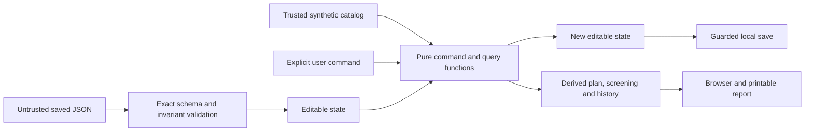

# Current demo architecture

Technical authority as of October 17, 2026. This supersedes the production infrastructure and optional 3D roadmap in the preserved `fixlist-plan.md`. Andrew authorized advancing the scaffold into a working local journey, emphasizing business logic and tests over visual design. See the [implementation plan](superpowers/plans/2026-10-17-core-workflow.md), [product hypothesis](product-validation.md), and [current execution evidence](validation-facts-catalog-2026-10-17.md).

## Objective and implementation boundary

Demonstrate a repeatable chain: fictional room observation → checklist answer → separate human confirmation → computed action plan → fact-based fictional screening → local family request history → printable report. The demonstration must work without implying real assessment, approval, outreach, identity verification, or repair verification.

The domain engine, validated storage, browser journey and print integration are implemented and independently checked. The validation report separates deterministic coverage, actual desktop/native print inspection, the bounded iOS Safari check and remaining product questions. Eight concerns across five text-only fictional rooms exercise the architecture. Seven fixed fictional profiles and two invented programs demonstrate matching, failure and missing facts. No images, new design system, native capture, or server are required.

Following Andrew's request to retain useful parts of the larger proposal, this local-demo scope remains in place. The [plan integration review](plan-integration-review.md) selects its useful additions: fact-based screening over fictional profiles, a small structured concern/action catalog, funding-work relevance distinct from applicant criteria, and later one-county resource verification. The first two increments are now implemented: fact screening and the expanded catalog, including work relevance. The one-county resource pilot remains gated. See [current acceptance evidence](validation-facts-catalog-2026-10-17.md). Keep all rules in the existing TypeScript domain and data layers.

## Structure and dependencies

| Location | Responsibility |
| --- | --- |
| `src/data/demo-scenario.ts` | Trusted authored synthetic catalog: rooms, observations, checklist/action links, eight concerns/actions and two fictional program rule trees. |
| `src/data/fictional-profiles.ts` | Five typed fact definitions and seven fixed fictional profiles. |
| `src/domain/types.ts` | Source, evidence, confirmation, program and family-report contracts. |
| `src/domain/workflow.ts` | Editable state, typed commands, immutable transitions, initial state, request activity views; shared public import surface. |
| `src/domain/rules.ts` | Confirmation prerequisites, canonical timestamp checks, fixed fictional identities and history notices. |
| `src/domain/plan.ts` | Derived grouped actions, evidence and selection/order explanations. |
| `src/domain/fact-screening.ts` | Typed rule validation and full three-valued explanation trees. |
| `src/domain/screening.ts` | Program status and independent work-category relevance. |
| `src/domain/catalog.ts`, `coverage.ts` | Authored catalog integrity and per-room sample answer coverage. |
| `src/lib/demo-storage.ts` | Runtime validation, trusted reconstruction, origin-local storage, reset and explicit failures. |
| `src/app/` | React controls, the coverage floor plan and the printable view; business rules remain in the domain. |
| `src/styles/` | Plain screen/print CSS tokens, native controls and visible focus. Design rules are in `frontend-design-2026-10-17.md`. |
| `docs/` | Decisions, source review, evidence, recording plan and factual assistance log. |
| `recordings/` | Ignored local screenshot/video/PDF evidence; only its README is tracked. |

React/React DOM **19.3.1**, TypeScript **7.0.2**, Vite **8.3.4**, Vite React plugin **6.1.2**, and Vitest **5.0.5** remain exact versions. Node **24.18.0** and npm **11** are required. `package-lock.json` fixes the resolved graph. The only additions since the core build are three self-hosted SIL OFL font packages at exact versions (`@fontsource-variable/atkinson-hyperlegible-next`, `@fontsource/atkinson-hyperlegible-mono`, `@fontsource/zilla-slab`, all **5.3.0**); they ship local woff2 files, not a font CDN. There is no router, component kit, state library, backend, database, PDF library, analytics or external API.

The initial JavaScript budget remains **250 KiB gzip**. Report Vite's measured output separately from this budget; it does not establish latency. Add dependencies only for a demonstrated need.

## State and computation

`DemoState` carries version/scenario identity, checklist answers, separate confirmations, an allowlisted fictional profile ID and local request history. It never stores an authoritative plan or screening result. The catalog is code, not browser data. `createInitialState` returns fresh state: unknown checklist answers, no confirmations or mutable requests, and `unknown-profile`. Profile facts, rule definitions and derived results are never stored. Selecting a profile changes only that ID.

`applyCommand` takes a trusted scenario, validated state and typed command, returning new state or a descriptive error. It never reads a clock, accesses storage or sends anything. The UI supplies a canonical ISO timestamp for explicit confirmation/completion. It is a local report timestamp, not an independently verified event time.



This is an internal typed interface, not an authenticated API accepting arbitrary network JSON. Its defensive guards do not establish a secure production API. A future server needs its own command parser, authorization, consent and ownership rules.

## Confirmation and computed plan

Checklist values are `unknown | yes | no`. Yes alone creates no plan item. A concern requires a nonempty valid evidence chain, known backing checklist/action IDs, matching action references, yes for every backing answer, and separate explicit family confirmation. Changing a backing answer away from yes clears dependent confirmations in that transition. Restoring yes still requires another confirmation.

`computePlan` selects confirmed concerns, groups them by reference action, deduplicates evidence, and orders actions by authored catalog position with stable concern/evidence IDs. The explanation names the source concerns and ordering rule. This is demonstration review order, not a validated priority/risk score. Action text remains synthetic example content, not professional guidance or a complete home assessment.

## Assistance screening

`evaluateFactRule` validates typed boolean, bounded numerical and enum definitions; the entire predicate tree; and all supplied facts before evaluating anything. Supported operations are equality, inclusive `gte`/`lte`, `all` and `any`. Missing/null facts remain unknown; false and zero remain known. Exact shapes, compatible types, unique IDs, maximum depth 8 and maximum 64 nodes reject malformed or hidden invalid branches. Ordinary getters/custom prototypes are rejected without execution; proxies are outside the JSON-data contract.

`all` uses failure, then unknown, then met; `any` uses met, then unknown, then failure. Every child explanation remains available. `screenProgram` derives `known_criterion_not_met`, `needs_information` or `criteria_matched` from that result. Invalid definitions/facts show screening unavailable. Seven fixed fictional profiles exercise two clearly invented programs; there are no editable criterion outcomes or private household inputs.

Work relevance independently compares the current confirmed actions' authored funding tags with a program's authored coverage tags. Its states are relevant, not relevant, and no confirmed work to compare. A relevant action does not make a failing or unknown applicant match, and matched applicant criteria do not imply relevant work. Unmodeled requirements remain visible. Both programs are synthetic, explicitly nonexistent, with no contact or verification date. No result establishes real eligibility, availability, funding or approval.

The catalog is validated before rendering. Actions carry unknown cost, an authored family/professional review route, funding tags, and a separate CDC checklist reference. Reference material does not verify the fictional observation, routing, cost or ranking. Professional-review requests record seeking suitable help; the fictional helper label does not establish qualifications. `computeCoverage` counts answered/unknown questions per room. Fully answering eight sample questions is not a complete assessment or a safety finding.

## Family records and retained history

Requests can be created only for actions in the computed plan. One deterministic record per action begins as a draft with fixed fictional attribution and unconfirmed completion. Allowed status edges are draft → family-reported requested → family-reported in progress. Completion is a separate explicit command allowed after requested/in-progress; it records family attribution/time. Reopening clears completion. Status changes never send messages.

Removing confirmation removes the plan action but retains its request as inactive history. Inactive records cannot be updated. Reconfirming permits updates without erasing or independently validating the prior report. A persistent notice states that the report does not resolve any current/new concern or verify a repair. Completion never removes a plan action.

## Persistence and errors

The only key is `fixlist:demo:v1`; payload schema version is 2; the key intentionally stays unchanged. Load validates exact fields, known IDs, enums, fixed synthetic text/source attribution, canonical dates, confirmation prerequisites, request uniqueness and completion/status consistency. It rejects malformed JSON, unknown versions/scenarios/keys, arbitrary text, and serialized data above 64 KiB. It reconstructs fresh state from known IDs/constants. TypeScript alone does not validate JSON.

Exact original schema-v1 data is validated before migration. Original rug/cord answers, confirmations and valid request history survive; new questions become unknown and the profile becomes `unknown-profile`. Legacy manually selected criterion statuses are discarded with a visible explanation because facts cannot be inferred from them. Migration never expands the legacy allowlist to accept new IDs. Malformed legacy and future versions are rejected without changing saved bytes. The next explicit successful command may save v2.

Loading and migration are read-only, including recovery. Save occurs only after a successful explicit command. Storage acquisition, reads, writes and deletion may fail; results carry truthful messages and preserve usable in-memory state. Reset resets memory and removes only this key. Failed deletion warns that reload may restore older data; reset does not auto-write fresh state to obscure the failure. Other applications' keys are untouched.

Storage is origin-specific: ports 5173 and 4173 have separate state. It is not an account, access-control boundary, backup, cross-device sync, or multi-user conflict resolution. Only synthetic values are allowed; there is no private media or free-text household input. See the [adapter contract](../src/lib/README.md) and [MDN localStorage](https://developer.mozilla.org/en-US/docs/Web/API/Window/localStorage).

## Print and browser acceptance

Use native `window.print()` with dedicated `@media print` output. Include confirmed action evidence/order, fictional sources, sample coverage, selected profile/facts, complete rule explanations, independent work relevance, unknown costs/routing/references, local family attribution/history limits, and generation time. An on-screen report does not prove native pagination or a valid saved PDF. Record native preview and PDF checks separately. See [MDN printing](https://developer.mozilla.org/en-US/docs/Web/CSS/Guides/Media_queries/Printing).

Runtime checks must exercise real controls, undo/reconfirmation, screening transitions, completion/reopening/inactive history, reload/reset, storage errors, narrow layout, keyboard use, console errors and print. iOS Safari simulation is additional compatibility evidence, not a native app or physical-device outcome test.

## Commands and acceptance gates

```sh
npm ci
npm test
npm run typecheck
npm run build
npm run dev
```

Development uses `http://127.0.0.1:5173`; `npm run preview` serves the build at `http://127.0.0.1:4173`. Both use strict ports. `npm test` now requires tests; `--passWithNoTests` was removed. Run focused tests after relevant fixes, then full checks at integration. Build success or a test count alone is not browser, product or submission acceptance.

Continue when the synthetic journey and uncertainty invariants pass. Block filming for false confirmations, stale plans, misleading save/reset results or print omissions. Cut visual extras before weakening those rules. Preserve the [recording gate](video-shot-list.md).

Before submission, record significant student technical work and understanding, disclose actual AI/tools, and recheck [current CAC rules](https://www.congressionalappchallenge.us/wp-content/uploads/2026/05/2026-CAC-Rules.pdf). This AI-assisted implementation alone does not establish those requirements. No upload, publication, commit, push or deployment without authorization.

## Deferred work

Real household data, sourced professional guidance, verified local programs, accounts, invitations, trusted helpers, consent/access controls, server storage, production audit history, automatic hazard detection, GPU/3D work and outcome studies remain outside this demo. The [product validation plan](product-validation.md) sets usefulness tests and continue/pivot/stop criteria before expanding those systems.
