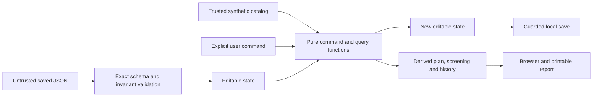

# Current demo architecture

Technical authority as of October 18, 2026 (roles domain/storage increment). This supersedes the production infrastructure and optional 3D roadmap in the preserved `fixlist-plan.md`. Andrew authorized advancing the scaffold into a working local journey, emphasizing business logic and tests over visual design. See the [implementation plan](superpowers/plans/2026-10-17-core-workflow.md), [product hypothesis](product-validation.md), and [current execution evidence](validation-facts-catalog-2026-10-17.md).

## Objective and implementation boundary

Demonstrate a repeatable chain: fictional room observation → checklist answer → separate human confirmation → computed action plan → fact-based fictional screening → local family request history → printable report. The demonstration must work without implying real assessment, approval, outreach, identity verification, or repair verification.

The previous core domain, storage, browser and print journey has recorded acceptance evidence; the roles domain/storage increment is implemented and awaits parent review. New role screens are pending. The validation report separates deterministic coverage, actual desktop/native print inspection, the bounded iOS Safari check and remaining product questions. Eight concerns across five text-only fictional rooms exercise the architecture. Seven fixed fictional profiles and two invented programs demonstrate matching, failure and missing facts. No images, new design system, native capture, or server are required.

Following Andrew's request to retain useful parts of the larger proposal, this local-demo scope remains in place. The [plan integration review](plan-integration-review.md) selects its useful additions: fact-based screening over fictional profiles, a small structured concern/action catalog, funding-work relevance distinct from applicant criteria, and later one-county resource verification. The first two increments are now implemented: fact screening and the expanded catalog, including work relevance. The one-county resource pilot remains gated. See [current acceptance evidence](validation-facts-catalog-2026-10-17.md). Keep all rules in the existing TypeScript domain and data layers.

## Structure and dependencies

| Location | Responsibility |
| --- | --- |
| `src/data/demo-scenario.ts` | Trusted authored synthetic catalog: rooms, observations, checklist/action links, eight concerns/actions and two fictional program rule trees. |
| `src/data/fictional-profiles.ts` | Five typed fact definitions and seven fixed fictional profiles. |
| `src/domain/types.ts`, `roles.ts` | Catalog, actor, grant, photo, sharing and revisioned help-request contracts; frozen old family types are for migration only. |
| `src/data/demo-people.ts`, `local-help-resources.ts` | Fixed fictional demo identities and separately sourced ACL resource. |
| `src/domain/role-views.ts` | Granted household views, field-limited volunteer projections and next-step selectors. |
| `src/domain/workflow.ts` | Editable state, typed commands, immutable transitions, initial state, request activity views; shared public import surface. |
| `src/domain/rules.ts` | Confirmation prerequisites, canonical timestamp checks, fixed fictional identities and history notices. |
| `src/domain/plan.ts` | Derived grouped actions, evidence and selection/order explanations. |
| `src/domain/fact-screening.ts` | Typed rule validation and full three-valued explanation trees. |
| `src/domain/screening.ts` | Program status and independent work-category relevance. |
| `src/domain/catalog.ts`, `coverage.ts` | Authored catalog integrity and per-room sample answer coverage. |
| `src/lib/demo-storage.ts`, `state-validation.ts`, `legacy-demo-state.ts` | Exact reconstruction, frozen legacy migration, origin-local persistence and owned-store reset. |
| `src/lib/photo-storage.ts` | JPEG re-encoding/downsize and serialized IndexedDB photo storage. |
| `src/app/` | React controls, the coverage floor plan and the printable view; business rules remain in the domain. |
| `src/styles/` | Plain screen/print CSS tokens, native controls and visible focus. Design rules are in `frontend-design-2026-10-17.md`. |
| `docs/` | Decisions, source review, evidence, recording plan and factual assistance log. |
| `recordings/` | Ignored local screenshot/video/PDF evidence; only its README is tracked. |

Use the exact installed dependency versions in `package.json` and `package-lock.json`, Node **24.18.0** and npm **11**. This increment changes no dependencies. React/TypeScript/Vite, local fonts and the separately lazy-loaded three.js/Spark scan viewer remain the existing stack; Capacitor packaging is separate work. Persistence uses localStorage plus dedicated IndexedDB photo/scan stores, with no backend, server database, analytics or remote API.

The initial JavaScript budget remains **250 KiB gzip**. Report Vite's measured output separately from this budget; it does not establish latency. Add dependencies only for a demonstrated need.

## State and computation

`DemoState` payload version 3 stores one Maple House household owned by Margaret, fictional demo people (Margaret, Sam, Alex, Jordan and user-created profiles), explicit delegation scopes, per-person language/guide/checklist progress, answers and attribution, separate confirmations and last-change attribution, an allowlisted screening profile ID, help requests, a photo metadata index, and the active person ID. There is exactly one resident; `create_person` cannot replace that resident. Roles of existing people cannot be edited. Plans and screening results remain derived from trusted catalog data.

Every `DemoCommand` requires `actorId` and a caller-supplied canonical ISO `at`. `applyCommand` enforces roles, grants, ownership, lifecycle and revisions without reading the clock, touching storage or sending messages. Attribution survives delegation revocation. Last-change attribution includes explicit unconfirmation and automatic confirmation removal after an answer changes. Fixture timestamps describe authored demo records; migrated records with unknown creation times retain null rather than inventing a time.



This is an internal typed interface, not an authenticated API accepting arbitrary network JSON. Its defensive guards do not establish a secure production API. A future server needs its own command parser, authorization, consent and ownership rules.

## Confirmation and computed plan

Checklist values are `unknown | yes | no`. Yes alone creates no plan item. A concern requires a nonempty valid evidence chain, known backing checklist/action IDs, matching action references, yes for every backing answer, and separate explicit family confirmation. Changing a backing answer away from yes clears dependent confirmations in that transition. Restoring yes still requires another confirmation.

`computePlan` selects confirmed concerns, groups them by reference action, deduplicates evidence, and orders actions by authored catalog position with stable concern/evidence IDs. The explanation names the source concerns and ordering rule. This is demonstration review order, not a validated priority/risk score. Action text remains synthetic example content, not professional guidance or a complete home assessment.

## Assistance screening

`evaluateFactRule` validates typed boolean, bounded numerical and enum definitions; the entire predicate tree; and all supplied facts before evaluating anything. Supported operations are equality, inclusive `gte`/`lte`, `all` and `any`. Missing/null facts remain unknown; false and zero remain known. Exact shapes, compatible types, unique IDs, maximum depth 8 and maximum 64 nodes reject malformed or hidden invalid branches. Ordinary getters/custom prototypes are rejected without execution; proxies are outside the JSON-data contract.

`all` uses failure, then unknown, then met; `any` uses met, then unknown, then failure. Every child explanation remains available. `screenProgram` derives `known_criterion_not_met`, `needs_information` or `criteria_matched` from that result. Invalid definitions/facts show screening unavailable. Seven fixed fictional profiles exercise two clearly invented programs; there are no editable criterion outcomes or private household inputs.

Work relevance independently compares the current confirmed actions' authored funding tags with a program's authored coverage tags. Its states are relevant, not relevant, and no confirmed work to compare. A relevant action does not make a failing or unknown applicant match, and matched applicant criteria do not imply relevant work. Unmodeled requirements remain visible. Both programs are synthetic, explicitly nonexistent, with no contact or verification date. No result establishes real eligibility, availability, funding or approval.

The catalog is validated before rendering. Actions carry unknown cost, an authored family/professional review route, funding tags, and a separate CDC checklist reference. Reference material does not verify the fictional observation, routing, cost or ranking. Professional-review requests record seeking suitable help; the fictional helper label does not establish qualifications. `computeCoverage` counts answered/unknown questions per room. Fully answering eight sample questions is not a complete assessment or a safety finding.

## Permissions and help-request history

The resident alone approves sharing, invites/cancels volunteers, cancels requests, grants/revokes delegation, changes the household screening profile, agrees visit proposals, and acknowledges/reopens completion reports. Sam and created family helpers require independent `checklist`, `confirm`, and `requests` grants to answer/add or remove their own photos, confirm/unconfirm, or create drafts. Photo removal always requires ownership, including for the resident. Any known demo person may create another demo profile, switch the active person, and change their own language/guide/resume preferences; these operations grant no household access. Volunteer skills/availability remain self-reported and unverified.

One deterministic request per action can be created only from the active confirmed plan, with `expectedRevision: 0`; it starts at revision 1. Every subsequent request mutation requires its current `expectedRevision`, increments it once, and appends an actor/time event. Lifecycle: draft → invited → accepted (or declined) → scheduled after a volunteer proposal and resident agreement → in_progress on the first update → volunteer_reported_done → resident_confirmed_done, or back to in_progress on “Not done yet”. Updates are 1–280 characters. The assigned volunteer alone accepts/declines, proposes, updates, reports done or withdraws. Duplicate acceptance and illegal/stale changes fail.

Withdrawal or resident `cancel_invitation` returns an open assignment to draft and clears assignment-specific details and sharing; decline retains `declined` with no assigned volunteer. The resident can prepare sharing and invite another volunteer from draft/declined. `cancel_request` is terminal and retained as history; confirmed completion is also terminal. Previous events remain. Professional actions can have a draft for finding qualified help but cannot invite volunteers; both authored effort and routing are checked. No electrical, structural, plumbing or grab-bar work is assigned to a volunteer. Independent verification is explicitly “not available in this demo”.

Removing confirmation retains requests as inactive history and suspends volunteer visibility and ordinary mutations. Privacy reductions (revoke sharing, cancel invitation/request, withdraw) remain possible while inactive. Reconfirming reactivates the action without verifying a repair or deleting history. No time-based invitation expiry is invented: the spec provides no expiry interval; cancelled, declined, withdrawn and inactive assignments fail closed.

`visibleRequestsFor(scenario, state, actorId)` constructs volunteer projections field-by-field. Only active invitations/assignments for that person appear. Title/nextStep and coordination records are always included; roomName, resident-owned photos for the action, an opaque scan-location ID, visitTimes and areaLabel have no object key unless shared. Whole requests, history, household answers and whole scans never enter this projection. Revocation removes a key immediately; the UI must say “They may already have seen this. Revoking stops future access on this device.” `visibleHouseholdFor` gives checklist/photos/scan capability for `checklist`, confirmation records for `confirm`, plan for `confirm` or `requests`, and request details for `requests`; volunteers receive null. These are local demo boundaries, not authenticated security against access to the device itself.

`elderNextStep` follows unanswered checklist (resuming the saved position), confirmable yes concern, create/invite or find professional for an active action, completion review/time agreement, wait, then done. The explicit wait result avoids calling pending volunteer work done. `volunteerNextStep` uses only visible assignments. Neither selector marks concerns safe or repairs verified.

## Catalog and photos

Each action has an authored `nextStep`, `effort` (`quick_fix`, `helper_task`, `professional`), and “Based on CDC 2017 Check for Safety” label alongside its existing guidance reference. `groupPlanByEffort` preserves catalog order within each group and explains: “Grouped by who can usually do it — a reading aid, not a risk ranking.” The catalog separately holds the verified [ACL Eldercare Locator](https://eldercare.acl.gov/) source, dated 2026-10-18; invented assistance programs remain synthetic and cannot acquire verification dates. The older plan/screening fixtures remain fictional.

`HouseholdPhoto` stores only ID, checklist item, owner/time and integer dimensions up to 1600 px. `photo-storage.ts` re-encodes pixels into a fresh JPEG using canvas, downsizes without upscaling, and stores blobs by ID in the dedicated `fixlist-photos` IndexedDB database / `jpeg-blobs` store. Re-encoding discards original metadata; originals and image bytes never enter localStorage, Git, public assets or an upload. The UI task must call `reencodePhoto`, save the blob, then dispatch metadata; handle failed writes/removals and use only projected photo IDs for volunteer reads. Camera/file inputs, rendering, print photo preparation and scan-pin image resolution remain UI integration work.

## Persistence and errors

The key remains `fixlist:demo:v1`; new saves contain payload version 3. `state-validation.ts` requires exact plain data shapes, bounded dense arrays, fixed fixture identities and one resident, known cross-record actors, explicit grants, canonical dates, confirmation prerequisites, request/action uniqueness, revision/event consistency, legal history transitions, assignment ownership and completion/proposal consistency. It reconstructs fresh trusted state. Free text is bounded user-authored demo text, never HTML. JSON and reconstructed output remain limited to 64 KiB. Unknown future schemas, getters, symbols and unsupported fields are rejected; recovery leaves saved bytes untouched.

`legacy-demo-state.ts` freezes the original v1/v2 contracts. Both migrate **in memory only**. v2 preserves answers, confirmations and selected fictional facts-profile ID; v1 keeps its original two-question allowlist, initializes new questions unknown, discards old criterion statuses and uses `unknown-profile`. Confirmations become attributed to “Family record (before roles)”. Every old request status (draft, family_reported_requested, family_reported_in_progress) maps to an **unassigned draft**, revision 1, sharing off, no proposal/report/acknowledgment, unknown creation time. Its original status and any family completion/time survive in `legacyHistory`, explicitly an inactive-history note. This deliberately infers no invitation to an unknown volunteer. A fresh explicit invite is needed, and a historical completion never becomes a volunteer report or resident acknowledgment. The draft's current activity still follows its plan action; its legacy note remains historical.

Load, migration and recovery never write. The next explicit successful command may save v3. Read/write/remove failures return truthful in-memory recovery messages. `resetDemoState` is the synchronous metadata primitive; the app awaits `resetFixListData`, which attempts that key plus the owned photo and scan stores even if another fails, reporting partial failures. Store queues order old writes before deletion. Other keys/databases are untouched. Ports 5173 and 4173 remain separate origins; this is no account, backup, sync or server authorization.

The existing screen dispatches as the resident and can still answer, confirm and create a draft. Its old family-status/completion buttons were removed because they bypass the new volunteer/resident lifecycle. Full elder/volunteer screens, switching controls, i18n, photo/print integration and iOS acceptance belong to the next task. No new dependency, commit, deployment or external send is part of this increment.

## Print and browser acceptance

Use native `window.print()` with dedicated `@media print` output. Include confirmed action evidence/order, fictional sources, sample coverage, selected profile/facts, complete rule explanations, independent work relevance, unknown costs/routing/references, local family attribution/history limits, and generation time. An on-screen report does not prove native pagination or a valid saved PDF. Record native preview and PDF checks separately. See [MDN printing](https://developer.mozilla.org/en-US/docs/Web/CSS/Guides/Media_queries/Printing).

Runtime checks must exercise real controls, undo/reconfirmation, screening transitions, completion/reopening/inactive history, reload/reset, storage errors, narrow layout, keyboard use, console errors and print. iOS Safari simulation is additional compatibility evidence, not a native app or physical-device outcome test.

## Commands and acceptance gates

```sh
npm ci
npm test
npm run typecheck
npm run build
npm run dev
```

Development uses `http://127.0.0.1:5173`; `npm run preview` serves the build at `http://127.0.0.1:4173`. Both use strict ports. `npm test` now requires tests; `--passWithNoTests` was removed. Run focused tests after relevant fixes, then full checks at integration. Build success or a test count alone is not browser, product or submission acceptance.

Continue when the synthetic journey and uncertainty invariants pass. Block filming for false confirmations, stale plans, misleading save/reset results or print omissions. Cut visual extras before weakening those rules. Preserve the [recording gate](video-shot-list.md).

Before submission, record significant student technical work and understanding, disclose actual AI/tools, and recheck [current CAC rules](https://www.congressionalappchallenge.us/wp-content/uploads/2026/05/2026-CAC-Rules.pdf). This AI-assisted implementation alone does not establish those requirements. No upload, publication, commit, push or deployment without authorization.

## Deferred work

Real accounts, shared persistence, authenticated invitations, vetted helpers, server-enforced consent/access, production audit history, automatic hazard detection and outcome studies remain outside this local demo. The roles/photo domain is implemented; new role screens and their iOS/print acceptance are pending. The [product validation plan](product-validation.md) sets usefulness tests and continue/pivot/stop criteria before expanding those systems.
